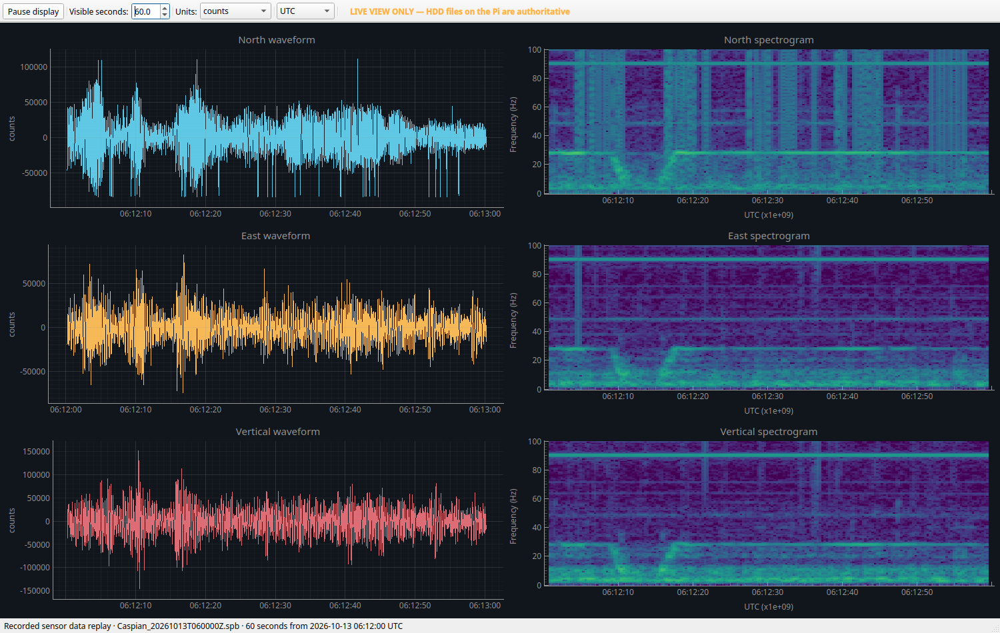
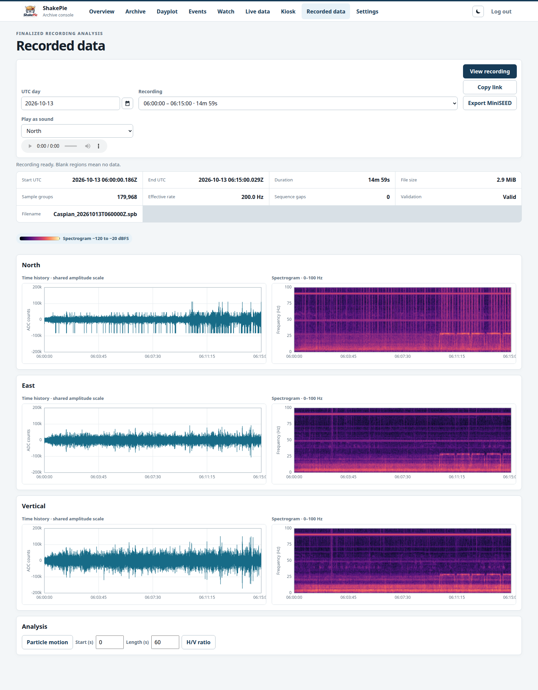

# ShakePie

ShakePie records three seismic components (north, east, and vertical) on a Raspberry Pi
using an ADS1256 ADC and a mounted HDD. It includes a desktop live monitor, a browser archive,
an SSH console, and an optional OLED status display.

The recorder runs headlessly. Disk recording continues independently of connected clients;
the separate live stream uses loopback TCP through an SSH tunnel.

**Status: experimental.** Software tests are included, but physical reliability, timing,
power-loss behavior, and long-duration operation still require the
[hardware validation checklist](docs/HARDWARE_VALIDATION.md).

## Preview

Desktop monitor displaying a 60-second replay of real N/E/Z sensor counts:



Browser viewer displaying the same real recording:



Both screenshots use `Caspian_20261013T060000Z.spb`, recorded on the Raspberry Pi with the
ADS1256 hardware backend on October 13, 2026, at 200 sample groups per second. The desktop
view shows 06:12–06:13 UTC; the browser view shows the full 06:00–06:15 UTC recording.
The recording passed file and block CRC32C checks with no sequence gaps. These previews
are not hardware validation results.

## Components

| Directory | Purpose | Requirements |
| --- | --- | --- |
| [`pi/`](docs/BUILD.md) | Headless recorder, recovery, health telemetry, live stream | Linux, C++20, CMake 3.20+, libgpiod 1.x or 2.x |
| [`protocol/`](protocol/FORMAT.md) | Portable binary framing, CRC32C, golden fixture | C++20; no external dependencies |
| [`laptop/`](laptop/README.md) | Native waveforms and spectrograms | Windows/Linux, Python 3.12+, PySide6 |
| [`archive-web/`](archive-web/README.md) | Archive, dayplots, live/recorded plots, event detection, settings | Python 3.12+; Gunicorn on the Pi |
| [`terminal/`](terminal/README.md) | SSH status, downloads, settings, calibration, logs | Python 3.12+ |
| [`oled/`](oled/README.md) | Optional SSD1306 128×32 status display | Linux, Python 3.12+, I²C |
| [`deploy/`](deploy/README.md) | Service installation and transfer scripts | OpenSSH; PowerShell for Windows scripts |

## Quick start

Clone the repository:

```sh
git clone https://github.com/QuakePie/ShakePi.git
cd ShakePi
```

### Raspberry Pi recorder

On Raspberry Pi OS, install the dependencies and build the recorder and tests:

```sh
sudo apt update
sudo apt install build-essential cmake ninja-build libgpiod-dev
cmake -S . -B build -G Ninja -DCMAKE_BUILD_TYPE=Release \
  -DSHAKEPIE_BUILD_PI=ON -DSHAKEPIE_BUILD_TESTS=ON
cmake --build build --parallel
ctest --test-dir build --output-on-failure
```

Follow [installation and operation](docs/OPERATIONS.md) to enable SPI, configure GPIO/HDD
access, edit [`recorder.conf`](pi/config/recorder.conf), and install the systemd service.
The HDD directory must be on the configured active mount; the recorder refuses startup otherwise.
N/E/Z use differential inputs AIN0–1, AIN2–3, and AIN4–5, sampled sequentially.
Verify your board's wiring and signal levels before connecting hardware.

### Desktop monitor

Keep this SSH tunnel open in a separate terminal:

```sh
ssh -N -L 8765:127.0.0.1:8765 <your-pi-user>@<raspberry-pi-host>
```

Install and launch from the repository root on Linux:

```sh
cd laptop
python3.12 -m venv .venv
.venv/bin/python -m pip install -e .
.venv/bin/shakepie-client
```

Or on Windows PowerShell:

```powershell
cd laptop
py -3.12 -m venv .venv
.\.venv\Scripts\python.exe -m pip install -e .
.\.venv\Scripts\shakepie-client.exe
```

Each Python component has its own installation instructions and environment. See the
component links above for the browser archive, SSH console, and OLED service.

## Configuration and access

- Configure the recorder using [`pi/config/recorder.conf`](pi/config/recorder.conf).
  Keep the ADC conversion rate greater than six times the sample-group rate.
- Use [`archive-web/deploy/archive-web.conf`](archive-web/deploy/archive-web.conf) and the
  blank [environment example](archive-web/deploy/archive-web.env.example) for the web service.
  Generate your own session secret and password hash during installation.
- Keep the live listener on `127.0.0.1:8765` and access it through SSH. The archive web
  interface on port 8050 requires authentication and should be restricted to a trusted LAN.
- Transfer scripts accept your own Pi username and hostname; see [deployment tools](deploy/README.md).
  Store passwords in prompts or environment variables, never in repository files.

## Development and documentation

[Build instructions](docs/BUILD.md) · [Tests and CI](docs/TESTING.md) ·
[Architecture](docs/ARCHITECTURE.md) · [Operations](docs/OPERATIONS.md) ·
[Troubleshooting](docs/TROUBLESHOOTING.md) · [Protocol](protocol/PROTOCOL.md) ·
[Known limitations](docs/KNOWN_LIMITATIONS.md) · [Historical validation report](docs/VALIDATION_REPORT.md)

GitHub Actions checks C++ on Linux/Windows and all four Python components. Qt tests run
offscreen; software tests do not certify physical hardware behavior.
Generated recordings, downloaded dayplots, credentials, and local backups are excluded
from Git. The protocol golden fixture remains included.

## License

ShakePie is available under the [MIT License](LICENSE).
